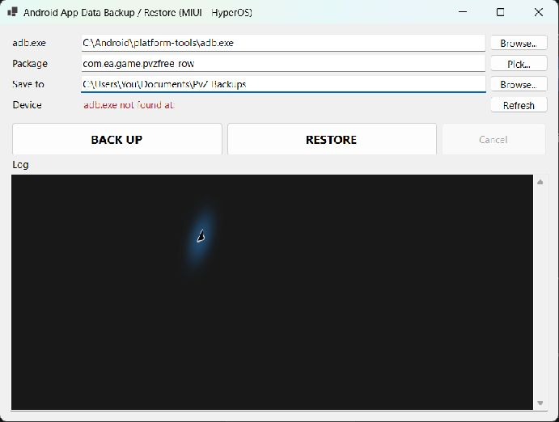

# PvzBackupTool

A Windows desktop utility for copying an Android app backup from a MIUI/HyperOS phone to a PC, and putting it back for restoration. It opens the phone's built-in MIUI backup screen; you complete the actual backup or restore on the phone.

The default package is the original Plants vs. Zombies Android package (`com.ea.game.pvzfree_row`), but you can select any installed third-party app.



## Requirements

- Windows 10 or later
- [.NET 10 SDK](https://dotnet.microsoft.com/download/dotnet/10.0) to build or run from source
- [Android SDK Platform Tools](https://developer.android.com/tools/releases/platform-tools), including `adb.exe`
- A MIUI or HyperOS Android phone that provides the local backup app
- USB debugging enabled on the phone

## Set up the phone

1. On the phone, enable **Developer options**: tap **MIUI version** or **OS version** seven times in *Settings → About phone*.
2. In *Settings → Additional settings → Developer options*, enable **USB debugging**.
3. Connect the phone by USB, unlock it, and accept the **Allow USB debugging** prompt.

## Get ADB (Android Platform Tools)

1. Download the Windows Platform Tools ZIP from the [official Android download page](https://developer.android.com/tools/releases/platform-tools).
2. Extract it somewhere convenient, for example `C:\Android\platform-tools`.
3. In this tool, use **Browse...** beside `adb.exe` and choose the extracted `adb.exe` file.

## Run it

Either double-click `Run.bat`, which builds a Release executable on its first run, or run:

```powershell
dotnet run --project .\PvzBackupTool.csproj
```

In the application:

1. Use **Browse...** beside `adb.exe` to select `adb.exe` from Android Platform Tools.
2. Enter an Android package name or use **Pick...** to choose an installed third-party package.
3. Choose the PC folder where backups should be saved.
4. Check that the Device row shows your phone as `device`.

The app remembers these three settings under your local application-data folder.

## Back up

1. Click **BACK UP**.
2. The tool opens the MIUI local-backup screen on the phone.
3. On the phone, unlock it if necessary, accept any prompt, deselect all apps, select only the app you want, and tap **Back up**.
4. Wait for the tool to detect that the resulting archive is finished writing. It copies the archive to the chosen PC folder, verifies the file size, and validates the archive.
5. Where possible, it also extracts readable app data to `SAVE-DATA-ONLY` beside the archive. The original `.zip` is the restoreable backup—keep it.

## Restore

> **Warning:** restoring with MIUI replaces the selected app's current data. Back up any newer progress first.

1. Click **RESTORE** and select a previously created MIUI backup `.zip`.
2. Review the confirmation dialog and select **Yes**.
3. The tool copies the archive to `/sdcard/MIUI/backup/AllBackup` on the phone and opens MIUI Backup.
4. On the phone, open the indicated dated backup, select the app, and tap **Restore**. Leave the phone alone until it finishes.

## Notes and limitations

- This tool depends on MIUI/HyperOS's local-backup feature and is not a general Android backup solution.
- It requires exactly one connected, authorized Android device.
- If the phone does not expose the MIUI backup activity or uses a different backup format, backup and restore will not work.
- Extracted data is for inspection/convenience. Use the original MIUI `.zip` for restoring.
- Backup archives may contain private app data. Store them securely and never commit or upload them unintentionally.

## License

This project is licensed under the [MIT License](LICENSE).

## Build a release executable

```powershell
dotnet build .\PvzBackupTool.csproj -c Release
```

The output executable is `bin\Release\net10.0-windows\PvzBackupTool.exe`.
